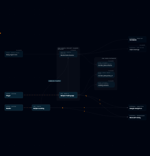
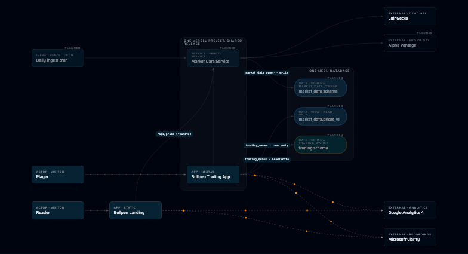
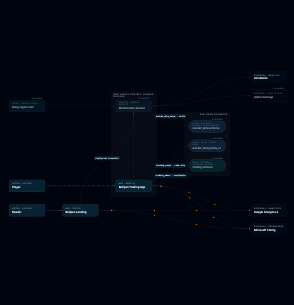
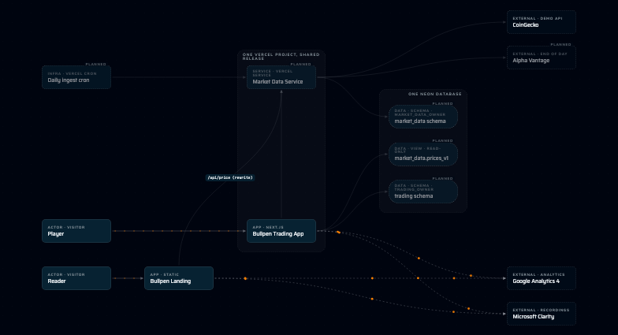
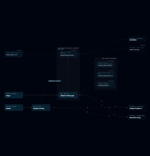

# The Part 3 picture, laid out left to right

Date: 2026-10-16. The explorer draws Part 3 from `content/architecture/part-03.json`, which the consistency check holds to the
part-03 CALM moment. Nothing about the model changed: the same nodes and connections, drawn differently.

## What changed

- **No separate Bullpen Database card.** "One Neon database" is the database: the box is the node. The node stays in the model and
  in the part's list (the consistency check requires every CALM node to appear), the box stands for it (`groups[].nodeId`), and
  selecting the box's title selects it. The box stays when "Group by quanta" is switched off, because it is the database and not a
  grouping.
- **Left to right:** actors (Reader, Player, the daily ingest cron) → apps (Landing, then the one Vercel project box holding the
  Trading App and Market Data) → the database box (`market_data` schema, `prices_v1`, `trading` schema) → the outside services on the
  right edge (CoinGecko, Alpha Vantage, Google Analytics 4, Microsoft Clarity).
- **Lines join where the cards face each other** (`flow: "right"`): side to side across columns, top to bottom within one. A part
  without `flow` keeps bottom-to-top, so Parts 1, 2 and the planned parts look as they did.
- **The Landing → Market Data line says `/api/price (rewrite)`**, always (`caption` on the connection). The database roles
  (`trading_owner · read/write` and so on) still show only with "Data ownership" on.
- **The analytics lines stay on their own side**: Landing and the Trading App sit in the bottom band, level with Google Analytics and
  Clarity, so none runs up through the database or the services; the providers sit in the top band above the database box.
- **A phone shows the whole picture.** The canvas may now zoom out to 0.1 and a left-to-right part fits with 6% padding, so at 390 px
  the picture fits whole (it did not before: only a corner showed).

## What is held by a test

`apps/landing/e2e/architecture-layout.spec.ts`, at 1440 and 390 px (20 tests):

| Rule | How it is checked |
|---|---|
| Reads left to right | the left edge of each column's cards, from the page |
| Outside services on the right edge | their right edges are the picture's right edge |
| The database is a box, not a card | no card for `bullpen-database`; the three schemas sit inside the `neon-database` box |
| No line passes through a card it is not joined to, nor a box it has no end in | every line is sampled every 6 px along its path and tested against every card and box |
| Same with each toggle on | repeated with "Data ownership", "Group by quanta" and "Sync vs async" on |
| Analytics lines do not cross the picture | each rises or falls less than the distance between the Trading App and Market Data |
| The rewrite caption | `/api/price (rewrite)` is on screen with no toggle |
| Lines join at the facing sides | a line starts at the right side of the Player and ends at the left of the Trading App; the Trading App and Market Data line runs top to bottom |
| The box title selects the database | and the box survives switching the grouping off |

## Pictures

Each is the canvas only, with the toggle named on; "Group by quanta" is on by default, so its picture is the default one.

| Toggle on | 1440 px | 390 px |
|---|---|---|
| none (the default view) |  |  |
| Data ownership |  |  |
| Group by quanta |  |  |
| Sync vs async |  |  |

## What is still not good

- At 390 px the whole picture fits, but at about a fifth of its size: the card labels cannot be read without pinching in. I chose
  a complete picture over a readable corner; a taller canvas or a different phone layout is a separate decision.
- The Vercel box's title wraps onto two lines, because the box is as wide as one card plus its padding.
- Cards still show "PLANNED" and the dimmed look: Part 3 is built, but its content says `planned` until the publish commit flips it.
