# Traffic on the Part 3 picture

Date: 2026-10-16. Pulses travel along each line of the Part 3 explorer, in the direction of the request, as many as the line's rate says.
The rates are the part's own: each connection in `architecture/calm/moments/part-03.architecture.json` carries `bullpen:rate`
(`count`, `per`, `source`, `basis`), and `content/architecture/part-03.json` repeats it for the explorer; a test holds the two equal.

## Is there a flow-playback design to follow?

I looked in `design/export-2026-09-25-final` (`Architecture Page.dc.html`, `architecture.js`). It has the "flowing call" dash
(`bp-flow`), which the explorer already ported, and step-by-step flows (`flowsAt`) with no rates or density. There is no design for
traffic that depends on a rate, so this part is new. It keeps the design's two conventions: a synchronous line is solid with a steady
stream, and an asynchronous line is dashed with spaced pulses.

## Where each rate comes from

No number here is invented. Three sources, and the panel says which:

| Source | What it means | Lines |
|---|---|---|
| measured | I measured it. Both are from the load test (8 writers, 417 buys in 30 s, `contention.md`), not from users | Trading App → trading schema (14 a second); Trading App → `prices_v1` (14 a second, one read a buy) |
| configured | a setting in the repo, not a measurement | cron once a day (`vercel.json`); CoinGecko at most 12 an hour (the 300 s cache, ADR-0005); Alpha Vantage 10 a day under a cap of 20 (ADR-0008); 10 quote writes a day |
| illustrative | there is no production traffic yet; it shows that the line is used, not how much | Reader → Landing, Player → Trading App, Landing → Market Data, Trading App → Market Data, the four analytics lines |

"configured" is a third word beside the two you named: a cron schedule is a fact but not a measurement, and calling it either would be
wrong. Every illustrative line says so in the side panel ("Illustrative, 6 a minute. No production traffic yet.").

## How it looks and behaves

- **Density** is relative, on a log scale from "a few a day" (one pulse, a long wait between) to "600 a minute" (six pulses at once): six
  pulses are not six requests. A test holds the order: the load-test lines have more than the 6-a-minute lines, which have more than the
  hourly line, which has more than the daily cron.
- **Direction:** along each line from its source to its target (a test checks the first point of each path is nearest the source).
- **Sync vs async:** the daily cron's line is now asynchronous (dashed, spaced pulses), in the CALM moment too.
- **Data ownership on:** pulses take the colour of the owner of the node they leave (Trading's and Market Data's differ; the Landing's
  keep the ember). No line leaves a schema or `prices_v1`, so Trading's pulses end at the view and the trading schema.
- **Follow a price request / Follow a buy:** only the step being followed carries pulses (larger), and every other line is still and dim.
- **Ghosted or planned lines carry none.** While Part 3 is `planned`, the lines Part 2 already had pulse and the eight Part 3 adds do not;
  from the publish commit all fourteen do. In Part 4 and later, only lines carried forward from Part 3 pulse.
- **Reduced motion:** nothing moves. Each line has three static arrowheads along it and its rate written on it (`14/s`, `12/hour`,
  `1/day`), and the pause control is disabled and says "Traffic off · reduced motion".
- **Pause / play** for the traffic; pausing writes the rates on the lines, as reduced motion does.
- **The side panel is kept to the diagram's height** (480 px, 360 px when the two stack). With nothing selected it holds a summary (added, changed, removed, decisions, lines with a rate) and two buttons, "What changed" and "Traffic details".
- **The bottom sheet** ("Part 3 in detail", a native `<dialog>`) holds everything long, in two sections: **What changed** under headings (services, data and connections; new nodes and the rules on them; decisions; what week one predicted) and **Traffic** (an intro explaining Measured, Configured and Illustrative, then the connections in those three groups, one row each: pair, rate, one line of basis). It slides up at every width, is at most 70% of the viewport high and scrolls inside; it closes on its button, Escape and the overlay; focus goes in on open and back to the button on close; the page behind does not scroll; under reduced motion it appears in place.
- **Clicking a line** opens its own panel in the side panel: what it joins, whether it is synchronous, its caption, and its rate with where the rate comes from.

## Where it lives

A new module, `packages/ui/src/components/ArchitectureExplorerTraffic.tsx` (rates, pulse timing, pulses, control, panel), with the line
builder in `ArchitectureExplorerFlowEdges.ts`. The legacy `ArchitectureExplorer.tsx` gained only call sites: the playback hook, two
props passed to the line builder, the control, the panel (and lost the group and edge code I had already moved out).

## Tests

- `ArchitectureExplorerTraffic.test.tsx` (unit): the rate arithmetic and words; the pulse count rises with the rate; nothing is drawn when
  still; the control; the panel marks illustrative lines.
- `architecture.test.ts` (landing): every Part 3 connection has a rate with a source and a basis; the content equals the moment's
  `bullpen:rate`; only the two load-test lines are "measured"; the parser rejects a bad rate.
- `architecture-traffic.spec.ts` (e2e, 1440 and 390 px, 20 tests): every line carries pulses with its source; busier means more; direction;
  pause and play; Data ownership colours; one line at a time while following a price request and a buy; **reduced motion: no pulse moves,
  static arrows and rates are shown**; planned lines carry none; the panel. These run from the publish commit; before it, one test holds
  the planned state.
- The geometry spec and the consistency check still pass unchanged.

## Pictures and recordings

Taken with Part 3 temporarily marked built, because a planned line carries no pulses (the content is restored before commit).
Recordings: [1440 px](explorer/traffic-recording-1440.webm), [390 px](explorer/traffic-recording-390.webm) (about 10 seconds: the lines moving, then
Follow a price request).

| State | 1440 px | 390 px |
|---|---|---|
| Moving | 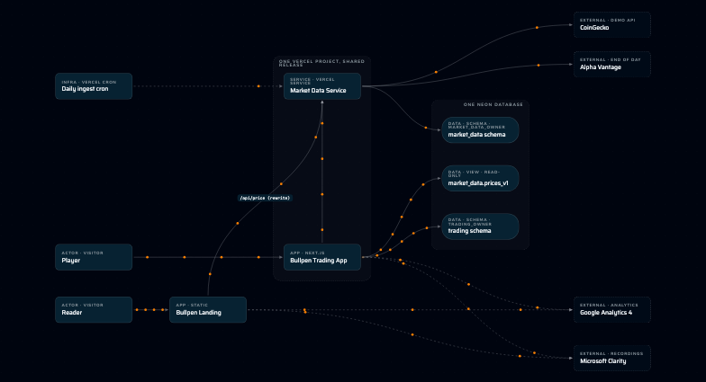 |  |
| Paused (rates written) |  | 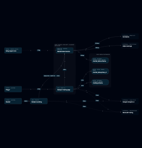 |
| Reduced motion | 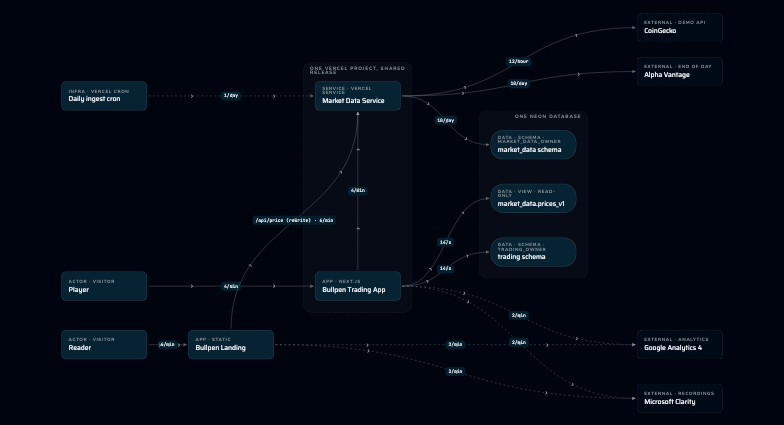 | 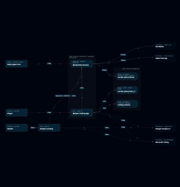 |
| Data ownership on | 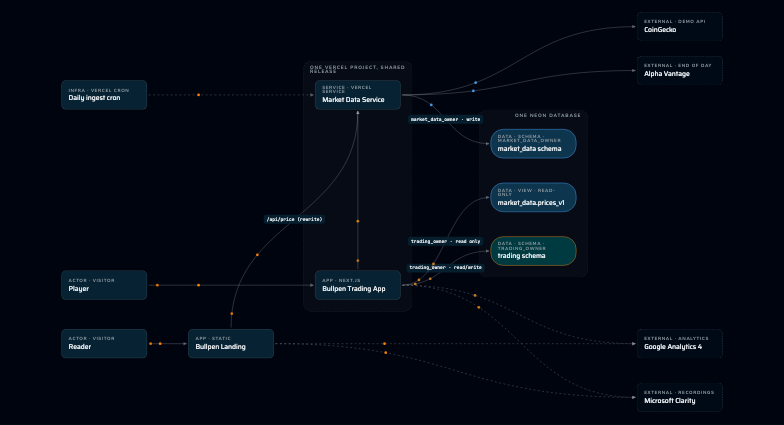 | 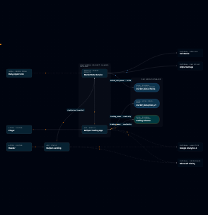 |
| Following a price request | 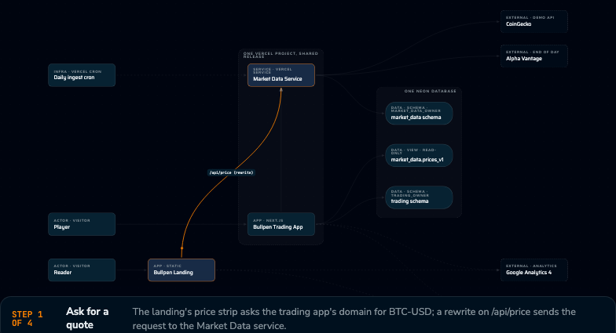 |  |
| Following a buy | 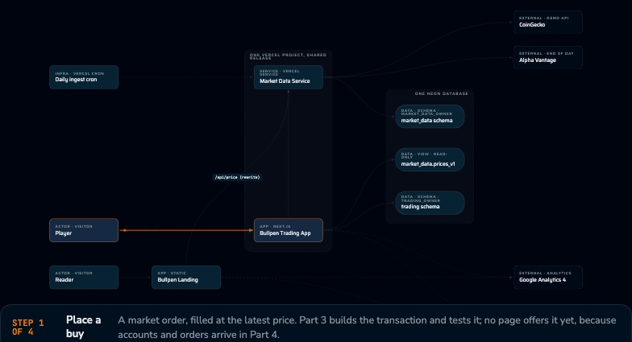 | 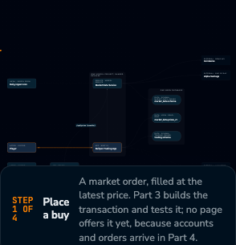 |
| Side panel, kept to the diagram's height | 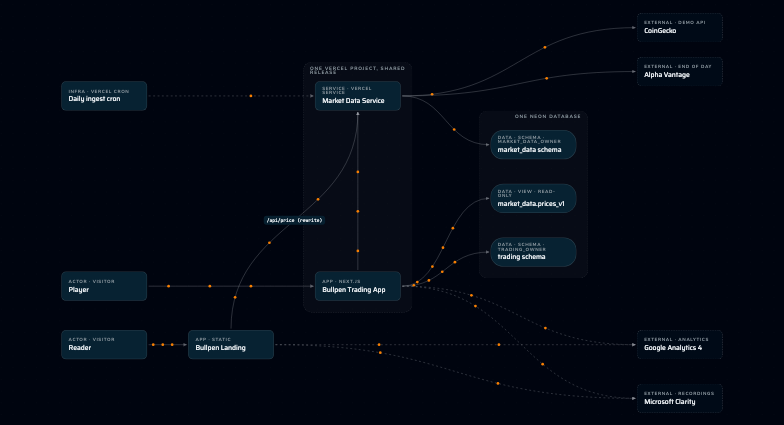 | 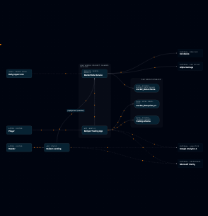 |
| Sheet open on Traffic | 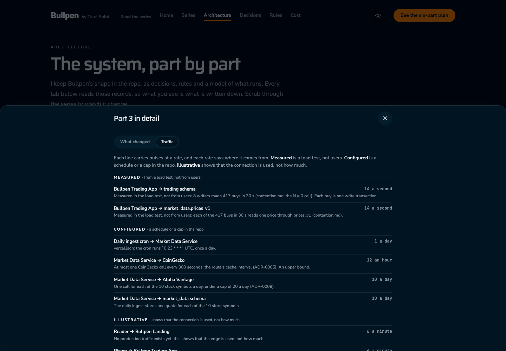 | 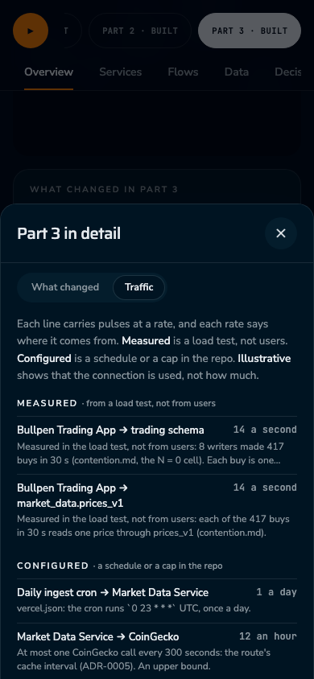 |
| Sheet open on What changed | 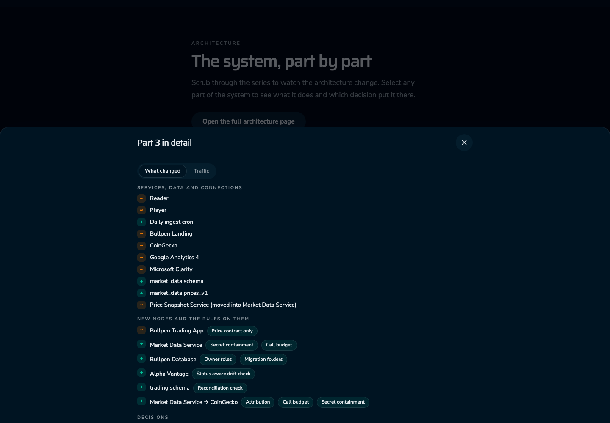 | 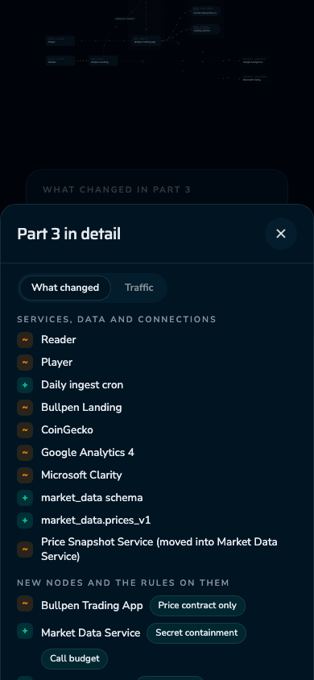 |
| A clicked line | 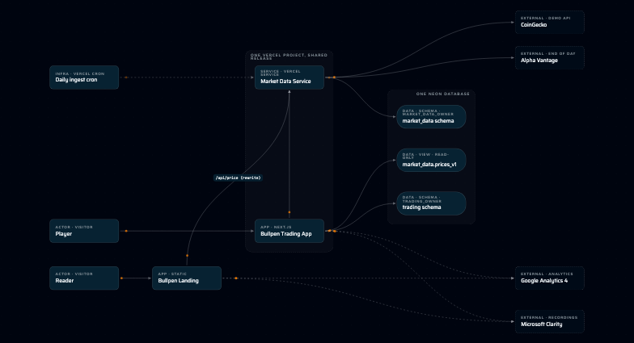 | 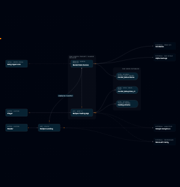 |

## Known gaps

- At 390 px the whole picture fits but is small: **fits, pinch to read.**
- The static pictures show pulses as dots; the recordings show them moving.
- The explorer file is a legacy 1,000-line component, so the code-metrics gate reports "worse" on six anonymous functions in it. It matches
  anonymous functions by position, not by name, and the same functions are listed as pre-existing without my change. Everything I wrote
  (the traffic module, the line builder, the parser) passes. I suppressed nothing.
