# The trading app, built from the design

Source: the final design export in `design/export-2026-09-25-final/` (the files are byte-identical to the zip I was given on
2026-10-16; the Claude Design project itself was not reachable from here, so the export is the reference). There is no
`design/brief.md` in the repo.

## Which frames cover the trading app, and what Part 3 builds from each

| Part 3 screen | Design frame | Built as | Status |
|---|---|---|---|
| Leaderboard, with its computed-at time | `Bullpen Portfolio and Leaderboard.dc.html`; `Bullpen Design System.dc.html`, LeaderboardRow 1d | `LeaderboardRow`, `LeaderboardList`, `Panel` in `packages/ui`; `apps/web/app/components/Leaderboard.tsx` | built |
| Price display, end of day, with stale and close states | Design System: PriceCell, "Close · 16:00 ET", "Stale, always labeled" | `PriceCell` (new `stale` and `asOfLabel` props), `TickerBadge`, `isUsMarketClosed` | built |
| Live price display (BTC-USD) | Design System: PriceCell | `PriceCell`, `ConnectionIndicator` | built |
| Empty and error states | Design System: "Empty" and "Error" cards | `EmptyState`, `ErrorState`, `Skeleton` | built |
| Account / portfolio (cash, positions, buying power) | `Bullpen Portfolio and Leaderboard.dc.html`, `Bullpen Terminal.dc.html` | not built | **waits on a player sign-in** |
| Buy ticket (market order at the latest `prices_v1` price) | `Bullpen Terminal.dc.html`, `Bullpen Mobile Trading.dc.html` | not built | **waits on a player sign-in** |

The last two need a signed-in player, and the repo has no sign-in, no account-read route and no buy route: accounts arrive in
Part 4, as the layout's own comment says. I built the screens a visitor can reach and stopped there, as I was told to when
the design has a frame but the product has no way in. They are listed here so the gap is visible, not hidden. The buy exists
and is tested at the transaction (`evidence-db-suite.md`); no page offers it.

## What I left out of a frame on purpose

- The leaderboard row's gain percentage and sparkline: they need an opening balance and a price history, and the ranking
  carries neither. Showing them would be invented data.
- The design's sample names, balances and tickers: none are in any component or test of the app. Tests use throwaway
  handles and prices that only exist in the test.
- A "market open" claim: `isUsMarketClosed` says closed on a weekend or outside 09:30-16:00 in New York, and says nothing
  otherwise, because it knows no exchange holidays and so cannot promise the market is open.

## Rules from the brief, and where each is held

| Rule | Where |
|---|---|
| Gain and loss never carried by colour alone | `PriceCell` prints ▲/▼ and a signed value with a true minus; `trading-screens.spec.ts` asserts "▼" and "−2.42%". Staleness is a word ("Stale", "stale · as of Oct 8") beside the toned price. The leaderboard shows no gain or loss |
| Tabular numerals for prices | `fontVariantNumeric: tabular-nums` on every price and equity; asserted in `trading-screens.spec.ts` |
| Works at 390 px | every screen and state is run at 1440 and 390 px, and each ends with a no-horizontal-scroll check |
| Tokens and components shared with the landing | all in `packages/ui` (`LeaderboardRow`, `Panel`, `PriceCell`, `isUsMarketClosed`); `apps/web/app/web.css` holds only page layout, as the landing's `landing.css` does |
| No design sample data in the HTML | the components take every value as a prop; `LeaderboardRow` has a test that it prints no gain, loss or percentage |

## Built, next to the design

`SCREENSHOT_DIR=<dir> pnpm --filter @bullpen/web exec playwright test e2e/trading-screens.spec.ts` writes one picture per state
and width into `design/built/`; the design frames below were cut from the export with Playwright.

| State | Design frame | Built, 1440 px | Built, 390 px |
|---|---|---|---|
| Leaderboard, ranked | 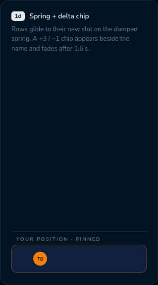 | 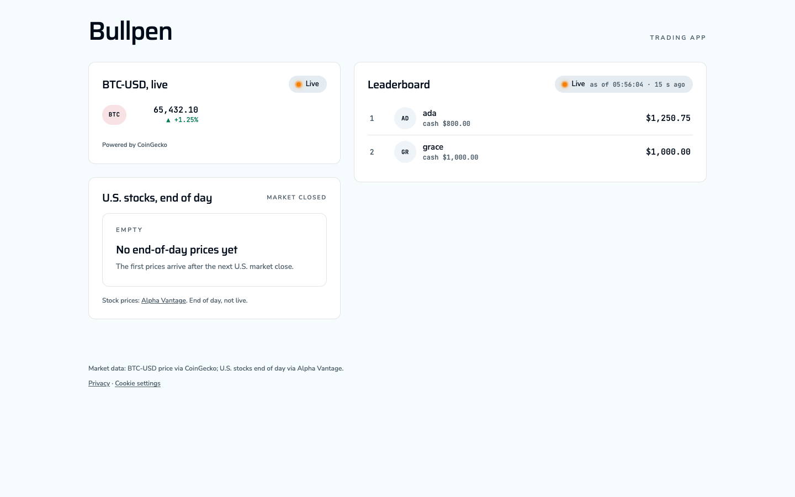 | 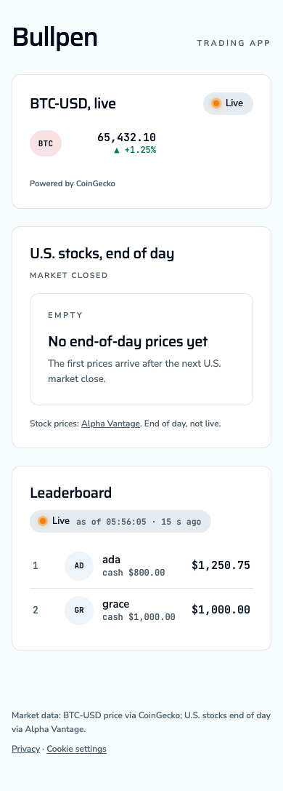 |
| Leaderboard, stale, last refresh failed | 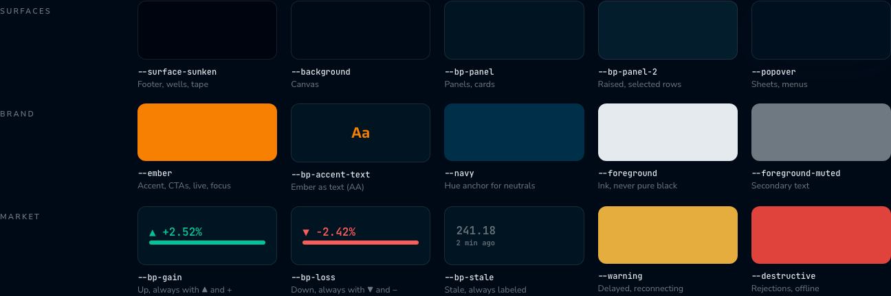 | 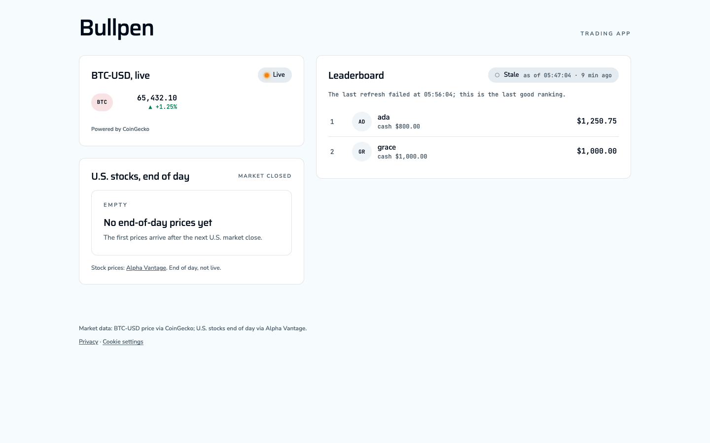 | 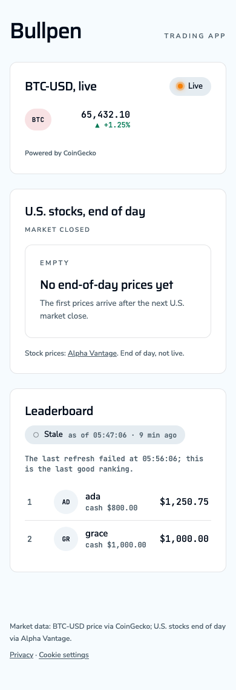 |
| Leaderboard, empty | 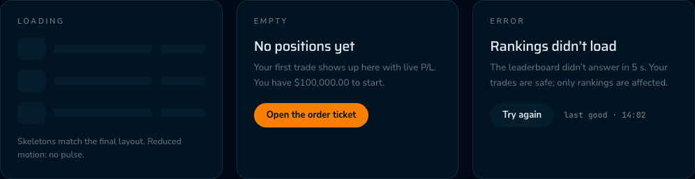 |  |  |
| Leaderboard, failed |  | 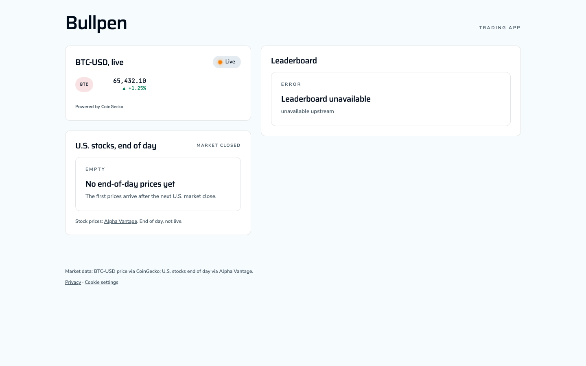 | 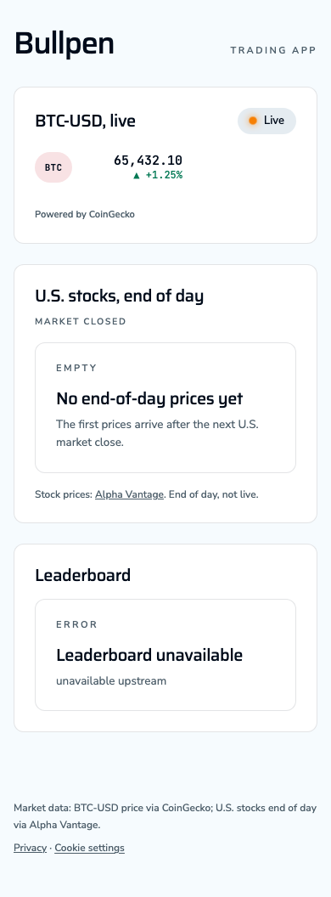 |
| Leaderboard, loading | | 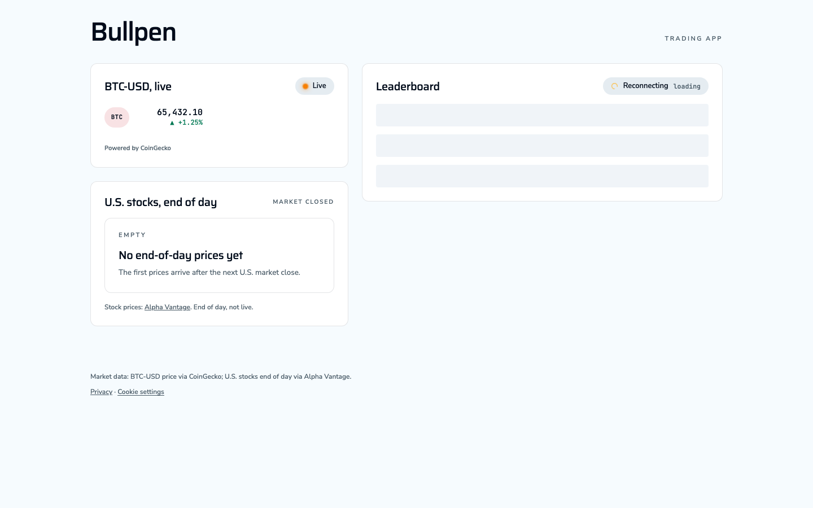 | 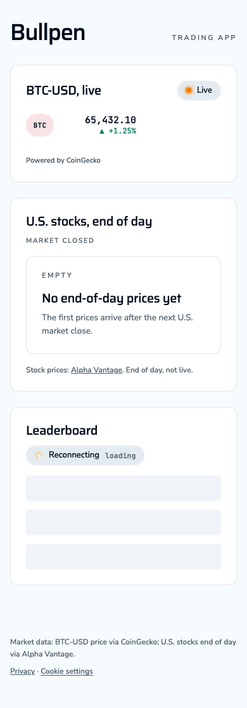 |
| Stocks, close and a stale close | 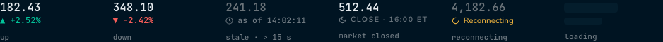 | 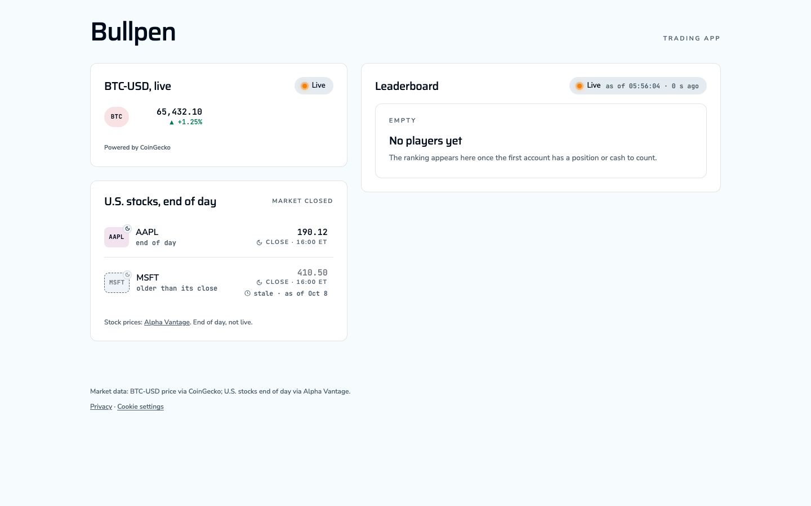 | 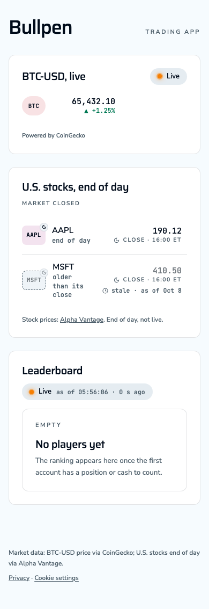 |
| Stocks, market closed |  | 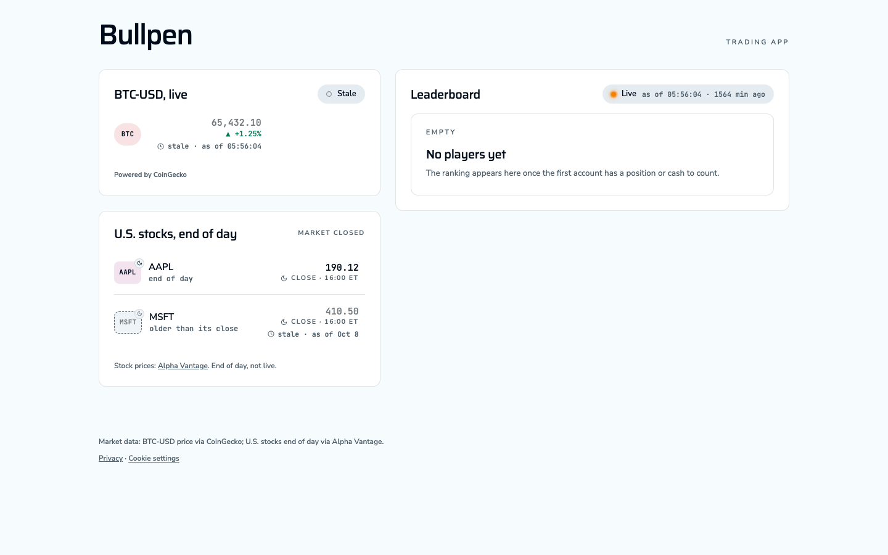 | 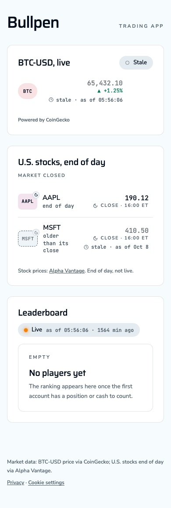 |
| Stocks, empty |  | 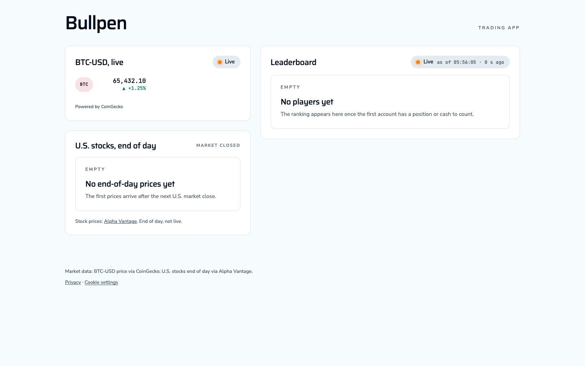 | 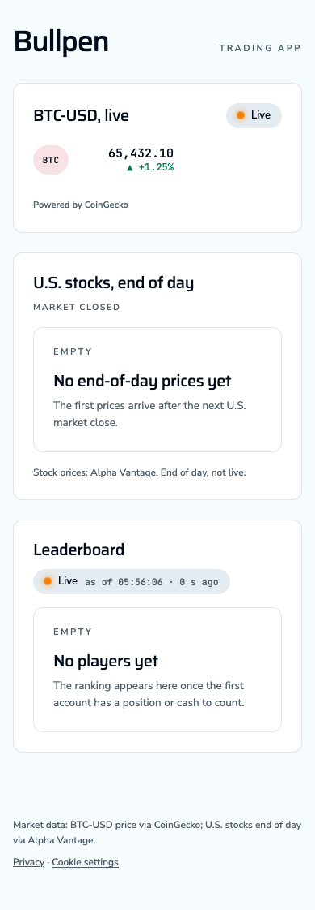 |
| Live price, falling | |  | 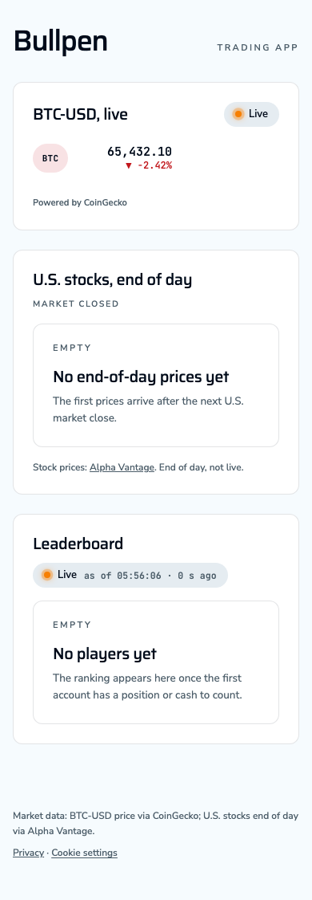 |
| Live price, stale |  | 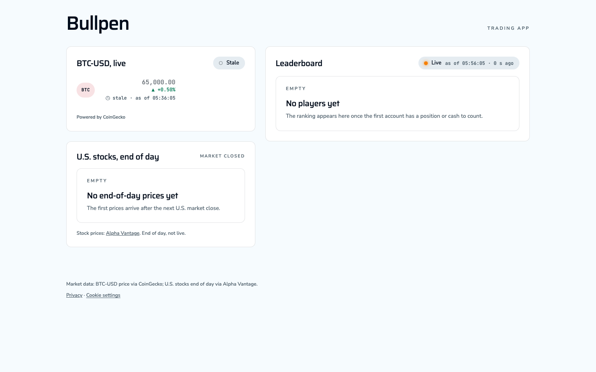 | 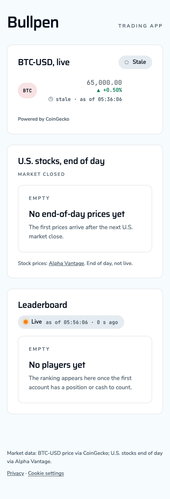 |
| Live price, failed |  | 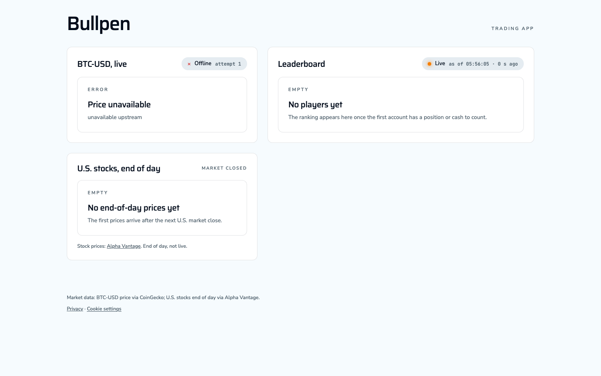 | 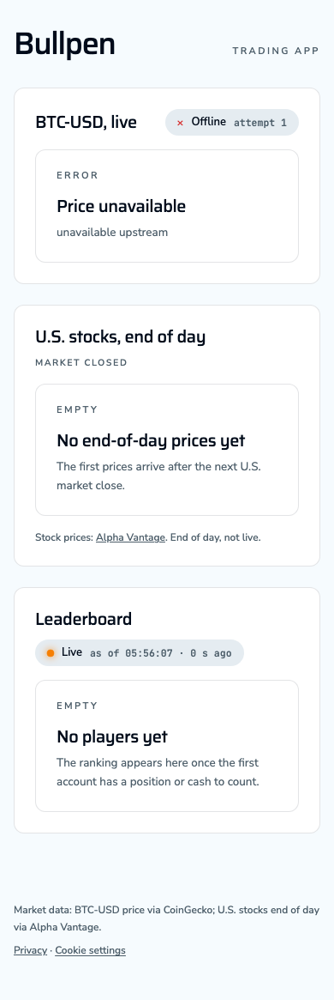 |
